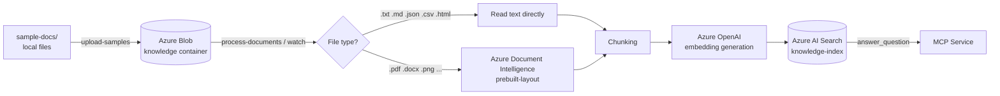

# Knowledge Ingestion

The purpose of this flow is to move documents from the Blob container into the **Azure AI Search** index and to keep the index up to date by watching for blob changes. This lets the MCP service pull current, searchable content from the knowledge base when answering user questions (`answer_question`).

The ingestion script lives here: [scripts/knowledge-ingestion/index.js](../scripts/knowledge-ingestion/index.js)

---

## Architecture Overview



The two core Azure services in this flow:

- **Azure AI Search** — The index that stores chunked text so it can be queried with both keyword and vector (semantic) search.
- **Azure Document Intelligence** — Extracts text from non-text files (PDF, scanned images, Office documents, etc.) using the `prebuilt-layout` model.

In addition, **Azure OpenAI** is used to generate embeddings, and **Azure Blob Storage** stores the source documents. Access to all services uses **keyless (RBAC)** authentication.

---

## What It Does

Depending on the command-line flags, the script runs the following steps:

1. **Create index** — Creates or updates the required Azure AI Search index (including the vector field).
2. **Upload samples** — Uploads the files in the `sample-docs/` folder to the Blob container.
3. **Sync** — Reads the files from Blob:
   - Parses text-based files (`.txt`, `.md`, `.json`, `.csv`, `.html`) directly.
   - Processes non-text files with Document Intelligence.
   - Splits each text into chunks.
   - Generates an Azure OpenAI embedding for each chunk.
   - Stores the chunks in the Search index on a per-chunk basis.
   - Rewrites the related records when a blob changes.
   - Deletes the Search records when a blob is removed.
4. **Watch** — Repeats the sync above automatically at fixed intervals.

The script tracks which blobs have been processed in the `.ingestion-state.json` state file (`etag` + `lastModified`), so unchanged files are not reprocessed on every cycle.

---

## Using Azure AI Search

The index is created by the `createSearchIndex` function in [scripts/knowledge-ingestion/index.js](../scripts/knowledge-ingestion/index.js). The resulting index (`knowledge-index`) contains the following fields:

| Field | Type | Description |
|-------|------|-------------|
| `id` | `Edm.String` (key) | Unique key for the chunk (`<blobName>-<chunkIndex>`) |
| `title` | `Edm.String` | File name |
| `source` | `Edm.String` | Source blob path |
| `content` | `Edm.String` | The chunk text (searchable) |
| `chunkIndex` | `Edm.Int32` | Chunk order within the file |
| `blobName` | `Edm.String` | Related blob name (delete/update filter) |
| `etag` | `Edm.String` | Blob version stamp |
| `lastModified` | `Edm.DateTimeOffset` | Blob last-modified time |
| `embedding` | `Collection(Edm.Single)` | Vector field (1536 dimensions by default) |

Vector search is configured with the **HNSW** algorithm (`default-hnsw`) and the `default-vector-profile` profile. This allows the MCP service to run both classic keyword search and semantic (vector) search.

### Vector field settings

The vector dimensions and field name must match the embedding model. For example, the `text-embedding-3-small` model produces 1536 dimensions. You can change these values via `.env`:

```env
AZURE_SEARCH_EMBEDDING_DIMENSIONS=1536
AZURE_SEARCH_VECTOR_FIELD=embedding
```

> Note: If you change the dimensions, the index must be recreated (`npm run create-index`), because the dimension of an existing vector field cannot be changed later.

---

## Using Azure Document Intelligence

Non-text files (PDF, scanned images, Office documents, etc.) are processed by the `extractTextFromBinary` function using Document Intelligence's `prebuilt-layout` model:

1. The file content is sent to the `POST .../documentModels/prebuilt-layout:analyze?api-version=2024-11-30` endpoint.
2. The service works asynchronously; the operation is tracked via the `operation-location` header in the response.
3. The script polls the result at fixed intervals until the operation is `succeeded`.
4. The extracted text (`analyzeResult.content`) is passed to the chunking step.

Authentication uses a bearer token acquired for the `https://cognitiveservices.azure.com/.default` scope.

> **Important:** If `AZURE_DOCUMENT_INTELLIGENCE_ENDPOINT` is not set, non-text files return empty text and are not added to the index. This service is not required if you only work with text files such as `.txt`/`.md`; however, you must configure it if you plan to process PDFs and similar files.

---

## Prerequisites

### Tools

| Tool | Check command |
|------|---------------|
| Node.js 20+ | `node --version` |
| Azure CLI | `az version` |

### Azure services

- Azure AI Search service
- Azure Blob Storage account and a container (default: `knowledge`)
- Azure OpenAI (embedding deployment, e.g. `text-embedding-3-small`)
- (Optional) Azure Document Intelligence (FormRecognizer) account

### RBAC roles (keyless access)

The script runs via RBAC using the signed-in user or a managed identity. The identity must be assigned the following roles:

| Service | Required role |
|---------|---------------|
| Storage account | `Storage Blob Data Contributor` |
| AI Search | `Search Index Data Contributor` (+ `Search Service Contributor` to create the index) |
| Azure OpenAI | `Cognitive Services OpenAI User` |
| Document Intelligence | `Cognitive Services User` |

> RBAC assignments can take a few minutes to propagate. If you get an `AuthorizationPermissionMismatch` error, wait a few minutes and retry.

---

## Environment Variables (.env)

The `.env` file must be located at the repo root. The following variables are used:

### Required

```env
AZURE_SEARCH_SERVICE=<search-service-name>
AZURE_STORAGE_ACCOUNT=<storage-account-name>
AZURE_OPENAI_ENDPOINT=https://<foundry-name>.openai.azure.com
AZURE_OPENAI_EMBEDDING_DEPLOYMENT=text-embedding-3-small
```

### Optional (with default values)

```env
# Search
AZURE_SEARCH_ENDPOINT=https://<search-service-name>.search.windows.net
AZURE_SEARCH_INDEX=knowledge-index
AZURE_SEARCH_EMBEDDING_DIMENSIONS=1536
AZURE_SEARCH_VECTOR_FIELD=embedding

# Storage
AZURE_STORAGE_CONTAINER=knowledge

# Document Intelligence (for non-text files)
AZURE_DOCUMENT_INTELLIGENCE_ENDPOINT=https://<docint-name>.cognitiveservices.azure.com

# Azure OpenAI
AZURE_OPENAI_API_VERSION=2025-04-01-preview

# Chunking settings
KNOWLEDGE_CHUNK_SIZE=1200
KNOWLEDGE_CHUNK_OVERLAP=200

# Watch interval (seconds)
KNOWLEDGE_INGESTION_INTERVAL_SECONDS=60
```

### Authentication mode

By default, `DefaultAzureCredential` is used. To force the Azure CLI session (`az login`) during local development:

```env
AZURE_AUTH_MODE=developer-login
# or
KNOWLEDGE_USE_AZURE_CLI_CREDENTIAL=true
```

If a managed identity is used, specify the client ID:

```env
AZURE_MANAGED_IDENTITY_CLIENT_ID=<managed-identity-client-id>
```

---

## Setup

```pwsh
cd scripts/knowledge-ingestion
npm install
```

---

## Running

Each command maps to an npm script in [scripts/knowledge-ingestion/package.json](../scripts/knowledge-ingestion/package.json).

### 1. Create the index

Creates or updates the Search index (including the vector field). Run this during initial setup and whenever you change the vector dimensions.

```pwsh
npm run create-index
```

### 2. Upload sample documents

Uploads the files in the `sample-docs/` folder to the Blob container. You can add your own documents to this folder and run it again.

```pwsh
npm run upload-samples
```

### 3. Sync (one-time ingestion)

Reads the files from Blob, extracts text, chunks it, generates embeddings, and writes to the index. Skips unchanged files and cleans up records for deleted files.

```pwsh
npm run sync
```

### Initial setup sequence (single flow)

```pwsh
cd scripts/knowledge-ingestion
npm run create-index
npm run upload-samples
npm run sync
```

### 4. Watch for blob changes

Runs the script in watcher mode. It checks the Blob container at fixed intervals and automatically syncs changed/deleted files. The default interval is 60 seconds (configurable via `KNOWLEDGE_INGESTION_INTERVAL_SECONDS`).

```pwsh
npm run watch
```

> Tip: Commands can be combined in a single run. For example, `node index.js --create-index --upload-samples --process-documents` runs the three steps in sequence.

---

## Chunking Logic

Each document is split into chunks of `KNOWLEDGE_CHUNK_SIZE` (default 1200) characters, with a `KNOWLEDGE_CHUNK_OVERLAP` (default 200) character overlap between adjacent chunks. The overlap reduces context loss at chunk boundaries and improves search relevance. Each chunk is indexed as a separate Search document and has its own embedding vector.

---

## Expected Result

- Per-chunk documents appear inside `knowledge-index`.
- The MCP service can pull content from Search during `answer_question` calls.
- As you add new files to Blob or update existing files, the index is updated on the next sync/watch cycle.
- Records for files deleted from Blob are also removed from the index.

---

## Troubleshooting

| Symptom | Likely cause and fix |
|---------|----------------------|
| `Missing required environment variables` | One of the required `.env` variables is missing. Check the list above. |
| `AuthorizationPermissionMismatch` (Storage) | The identity is missing the `Storage Blob Data Contributor` role, or RBAC has not propagated yet. Assign the role and wait a few minutes. |
| PDF/image files not added to the index | `AZURE_DOCUMENT_INTELLIGENCE_ENDPOINT` is not set, or the identity lacks the `Cognitive Services User` role. |
| `Document Intelligence analyze request failed` | The endpoint is wrong or permissions are missing. Verify the endpoint value and the RBAC role. |
| Empty blob skipped (`Skipped empty blob`) | No text could be extracted from the file (empty file or unsupported content). |
| Vector dimension mismatch | The embedding model dimension differs from `AZURE_SEARCH_EMBEDDING_DIMENSIONS`. Recreate the index. |